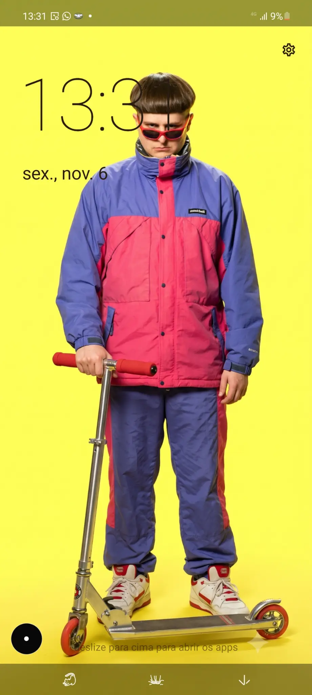

# Olauncher Minimal Kit

Launcher Android minimalista, sem anúncios e com foco em leitura rápida, acesso por gestos e baixo custo de renderização. Esta versão combina a base do Olauncher com a interface `MinimalLauncher`, implementada em Jetpack Compose.

> Este repositório descreve o estado atual da branch `main`. Ele não representa automaticamente o aplicativo publicado nas lojas Play Store, F-Droid ou IzzyOnDroid.

## Captura de tela

A captura abaixo mostra a tela inicial da versão atual: relógio e data, papel de parede escolhido pelo usuário, botão de configurações e gesto para abrir a gaveta de aplicativos.



## O que está implementado

### Tela inicial

- Relógio e data em destaque.
- Papel de parede controlado pelo seletor padrão do Android.
- Atalho para abrir as configurações do launcher.
- Atalhos opcionais para câmera, mapas e galeria/fotos.
- Até oito aplicativos favoritos na tela inicial.
- Gestos horizontais configuráveis para abrir um aplicativo à esquerda ou à direita.
- Gesto vertical para abrir a gaveta de aplicativos.

### Gaveta de aplicativos

- Lista de aplicativos instalados com agrupamento alfabético.
- Busca sem diferenciação de maiúsculas/minúsculas e tolerante a acentos.
- Opção para mostrar ou ocultar ícones.
- Ocultação individual de aplicativos ou ações para mostrar/ocultar todos.
- Acesso aos detalhes do aplicativo por toque prolongado.
- Deduplicação de pacotes antes do carregamento dos ícones.
- Cache reativo da lista de aplicativos para evitar novas varreduras do `PackageManager` ao reabrir a gaveta.

### Aparência e mídia

- Superfície translúcida com gradiente, reflexo e textura sutil.
- Blur da janela no Android 12 ou superior quando o recurso de blur entre janelas está disponível.
- Fallback translúcido e escurecido quando o blur nativo não está disponível.
- Blur dinâmico com ajuste dia/noite.
- Filtros de papel de parede: normal, preto e branco e sépia.
- Ajustes de desfoque, opacidade e escurecimento na tela de configurações.
- Widget opcional de mídia com capa, título, artista, anterior, reproduzir/pausar e próxima.
- O widget de mídia exige a ativação do acesso às notificações pelo usuário.

### Personalização

- Seleção de pacotes de ícones compatíveis com `appfilter.xml`.
- Preferências persistidas com DataStore.
- Migração das preferências legadas do Olauncher para a interface atual.
- Sliders persistidos com debounce para evitar gravações excessivas durante o arraste.

## Otimizações incluídas

A versão atual inclui otimizações focadas nos pontos mais caros da interface:

- carregamento dos aplicativos fora da thread principal;
- cache reativo compartilhado entre a tela inicial, a gaveta e as configurações;
- proteção contra carregamentos concorrentes com `Mutex`;
- ícones reduzidos para `64 × 64` antes de serem armazenados em memória;
- normalização dos nomes uma única vez para acelerar a busca;
- remoção das animações individuais e das coroutines por item da gaveta;
- isolamento do relógio para que o timer não recomponha a Home inteira;
- uso de `drawWithCache` para o shader da superfície de vidro;
- atualização do blur da janela somente quando os parâmetros relevantes mudam.

## Requisitos

- Android 8.0 ou superior (`minSdk 26`).
- Android 12 ou superior é recomendado para o blur nativo entre janelas.
- JDK 17 para compilar.
- Android SDK com a plataforma Android 36 e Build Tools compatíveis.

## Compilar

Clone o projeto e entre na branch principal:

```bash
git clone https://github.com/anonymous3210/olauncher-minimal-kit.git
cd olauncher-minimal-kit
git checkout main
```

Compile o APK de debug:

```bash
./gradlew assembleDebug
```

O arquivo será gerado em:

```text
app/build/outputs/apk/debug/app-debug.apk
```

O APK de debug usa o identificador `app.olauncher.debug` e é assinado com a chave de debug do Android. Para gerar o pacote de release:

```bash
./gradlew assembleRelease
```

O release é configurado com `minifyEnabled true` e precisa ser assinado com uma chave de distribuição antes de ser instalado ou publicado.

Para executar os testes unitários:

```bash
./gradlew testDebugUnitTest
```

## Instalação local

Com o Android Debug Bridge configurado:

```bash
adb install -r app/build/outputs/apk/debug/app-debug.apk
```

Depois da instalação, defina o aplicativo como launcher padrão nas configurações do Android. O aplicativo solicitará apenas as permissões e acessos necessários para recursos opcionais, como o widget de mídia.

## Estrutura do projeto

- `app/`: módulo Android principal, atividade, migração de preferências e integração com a base legada do Olauncher.
- `launcherkit/`: interface Compose, gaveta, tela inicial, preferências, cache de aplicativos, blur, ícones e widget de mídia.
- `docs/screenshots/`: capturas de tela usadas na documentação.

A entrada atual da aplicação é `MainActivity`, que hospeda `MinimalLauncher` e migra as preferências legadas antes de mostrar a interface Compose.

## Status da versão

A `main` contém as otimizações de carregamento de aplicativos e renderização da interface. O projeto compila com `assembleDebug` e `testDebugUnitTest` no ambiente configurado com Android SDK e JDK 17.

## Licença

Este projeto permanece sob a licença [GNU GPLv3](LICENSE).

## Créditos

A base original do Olauncher foi criada por [Tanuj Notes](https://github.com/tanujnotes). Esta versão e suas alterações estão mantidas neste repositório por [anonymous3210](https://github.com/anonymous3210).
